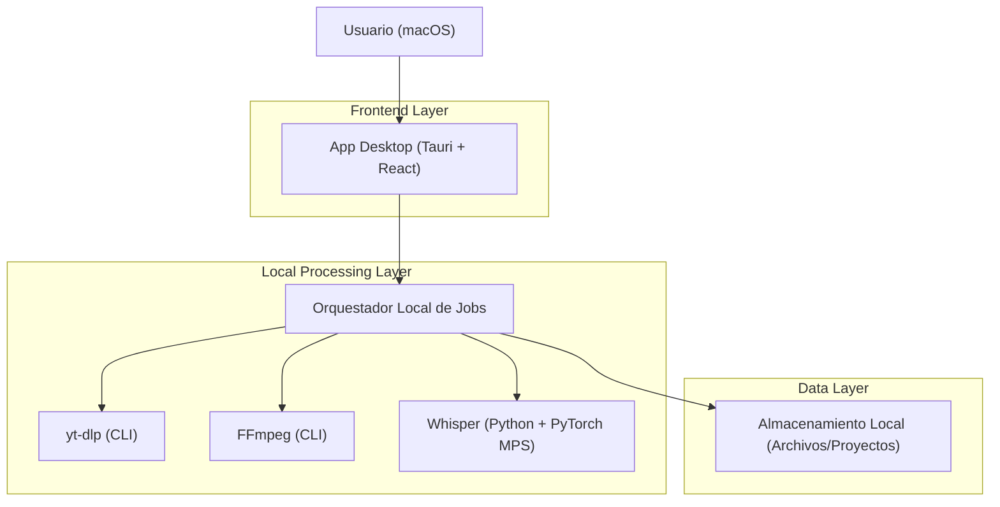
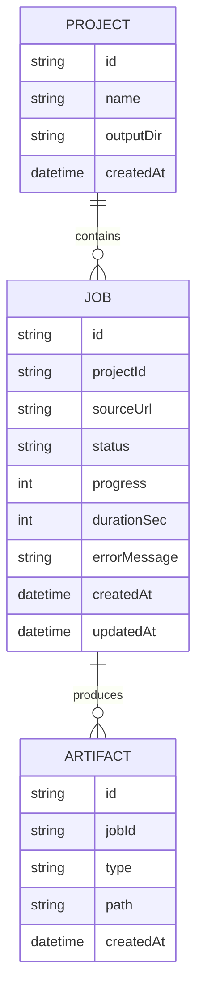

## 1.Architecture design


## 2.Technology Description
- Frontend: React@18 + vite + tailwindcss@3 (UI desktop-first)
- Desktop Shell: Tauri@2 (bridge seguro hacia el sistema)
- Backend: Local-only (sin servidor)
- Video: FFmpeg (render, overlay, recorte/escala, mux)
- Descarga: yt-dlp (TikTok URL → archivo fuente)
- Subtítulos: Python@3.11 + openai-whisper + PyTorch (MPS en Apple Silicon)
- Datos locales: SQLite (metadatos de trabajos) o JSON por proyecto (mínimo viable)

## 3.Route definitions
| Route | Purpose |
|-------|---------|
| / | Inicio: importar URLs, elegir preset, crear trabajos |
| /queue | Cola: seguimiento, control y logs por trabajo |
| /editor/:jobId | Editor: preview, overlay, subtítulos, exportación |
| /settings | Ajustes: dependencias, Whisper/MPS, defaults |

## 6.Data model(if applicable)
### 6.1 Data model definition


### 6.2 Data Definition Language
Project Table (projects)
```
CREATE TABLE projects (
  id TEXT PRIMARY KEY,
  name TEXT NOT NULL,
  output_dir TEXT NOT NULL,
  created_at TEXT NOT NULL
);
```

Job Table (jobs)
```
CREATE TABLE jobs (
  id TEXT PRIMARY KEY,
  project_id TEXT NOT NULL,
  source_url TEXT NOT NULL,
  status TEXT NOT NULL,
  progress INTEGER NOT NULL DEFAULT 0,
  duration_sec INTEGER,
  error_message TEXT,
  created_at TEXT NOT NULL,
  updated_at TEXT NOT NULL
);

CREATE INDEX idx_jobs_project_id ON jobs(project_id);
CREATE INDEX idx_jobs_status ON jobs(status);
```

Artifact Table (artifacts)
```
CREATE TABLE artifacts (
  id TEXT PRIMARY KEY,
  job_id TEXT NOT NULL,
  type TEXT NOT NULL,
  path TEXT NOT NULL,
  created_at TEXT NOT NULL
);

CREATE INDEX idx_artifacts_job_id ON artifacts(job_id);
```

Requisitos de instalación (macOS Apple Silicon, modo desarrollo/operación)
- Xcode Command Line Tools.
- Homebrew.
- `brew install ffmpeg yt-dlp python@3.11`
- `python3.11 -m pip install -U openai-whisper torch torchvision torchaudio`
- En la app: pantalla “Ajustes” valida rutas y habilita MPS.
