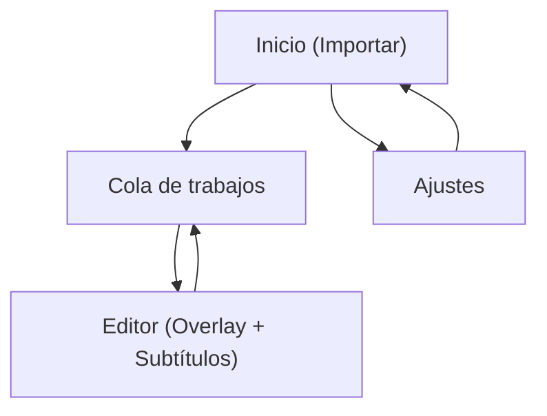

## 1. Product Overview
Aplicación de escritorio para macOS (Apple Silicon) que descarga videos de TikTok desde URLs y los transforma en clips verticales listos para publicar.
Automatiza recorte/normalización a 1080x1920 (<=55s), overlay y subtítulos generados con Whisper (MPS) + FFmpeg.

## 2. Core Features

### 2.1 User Roles
| Rol | Método de registro | Permisos principales |
|------|---------------------|----------------------|
| Usuario local | No aplica (app offline) | Gestionar descargas, procesar videos, configurar presets, exportar resultados |

### 2.2 Feature Module
La app requiere las siguientes páginas principales:
1. **Inicio (Importar)**: entrada de URLs, validación, selección de preset, carpeta de salida.
2. **Cola de trabajos**: estado/progreso, reintentos, cancelación, logs de cada job.
3. **Editor (Overlay + Subtítulos)**: previsualización, ajuste de overlay, estilos de subtítulos, regeneración.
4. **Ajustes**: rutas a binarios (FFmpeg/yt-dlp), modelo Whisper, aceleración MPS, límites por defecto.

### 2.3 Page Details
| Page Name | Module Name | Feature description |
|-----------|-------------|---------------------|
| Inicio (Importar) | Entrada de URLs | Pegar/añadir una o varias URLs de TikTok; validar formato y duplicados. |
| Inicio (Importar) | Presets de procesamiento | Elegir preset (1080x1920, <=55s) y parámetros base (recorte, padding, bitrate objetivo). |
| Inicio (Importar) | Gestión de salida | Seleccionar carpeta de salida; nombrado de archivos y política de colisiones. |
| Inicio (Importar) | Lanzar procesamiento | Crear trabajos y enviarlos a la cola con prioridad/orden. |
| Cola de trabajos | Lista y estados | Mostrar trabajos con estados (pendiente/descargando/procesando/subtítulos/exportando/fallo/listo). |
| Cola de trabajos | Progreso y métricas | Mostrar % por etapa, tiempo estimado y tamaño de salida. |
| Cola de trabajos | Acciones de control | Pausar/cancelar/reintentar; abrir carpeta de salida; copiar log. |
| Editor (Overlay + Subtítulos) | Previsualización | Reproducir preview (proxy) del resultado con overlay y subtítulos. |
| Editor (Overlay + Subtítulos) | Overlay | Elegir overlay (imagen/video), posición, escala, opacidad; aplicar a todo el clip. |
| Editor (Overlay + Subtítulos) | Subtítulos (Whisper) | Generar subtítulos en el idioma configurado usando Whisper con aceleración MPS; permitir regenerar. |
| Editor (Overlay + Subtítulos) | Estilo de subtítulos | Configurar tipografía, tamaño, color, borde/sombra, fondo, y safe-area para 9:16. |
| Editor (Overlay + Subtítulos) | Exportación final | Render final con FFmpeg con límites del preset (<=55s, 1080x1920); escribir archivo y artefactos (SRT/ASS). |
| Ajustes | Dependencias locales | Detectar/configurar rutas a FFmpeg y yt-dlp; validación con “Probar”. |
| Ajustes | Whisper y rendimiento | Elegir modelo (p.ej. base/small/medium), activar MPS, carpetas de caché/modelos. |
| Ajustes | Defaults del proyecto | Definir preset por defecto, plantilla de nombre, y concurrencia máxima. |

## 3. Core Process
**Flujo principal (usuario local)**
1. Instalas la app y dependencias locales (una sola vez).
2. Pegas una o varias URLs de TikTok en “Inicio”.
3. Seleccionas preset y carpeta de salida y envías a la cola.
4. La cola ejecuta: descargar (yt-dlp) → normalizar/recortar (FFmpeg) → aplicar overlay (FFmpeg) → transcribir y generar subtítulos (Whisper MPS) → render final (FFmpeg).
5. Revisas un trabajo en “Editor” para ajustar overlay/estilo y re-exportar si hace falta.
6. Abres la carpeta de salida y publicas el resultado.

**Instalación en macOS (Apple Silicon)**
- Usuario final: descargar `.dmg`/`.zip` → arrastrar a “Applications” → primer arranque (autorizar permisos si macOS lo solicita).
- Dependencias (si la app no las empaqueta):
  1) Instalar Homebrew.
  2) `brew install ffmpeg yt-dlp python@3.11`
  3) (Opcional para Whisper) `python3.11 -m pip install -U pip torch torchvision torchaudio`
  4) `python3.11 -m pip install -U openai-whisper`
  5) En “Ajustes”, pulsar “Probar” para confirmar FFmpeg/yt-dlp/Whisper.

